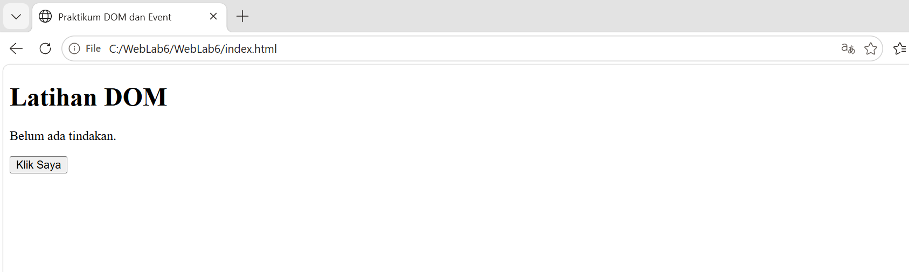
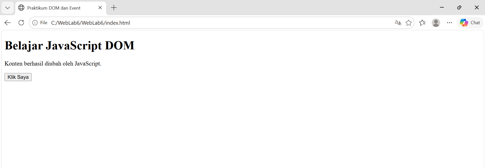
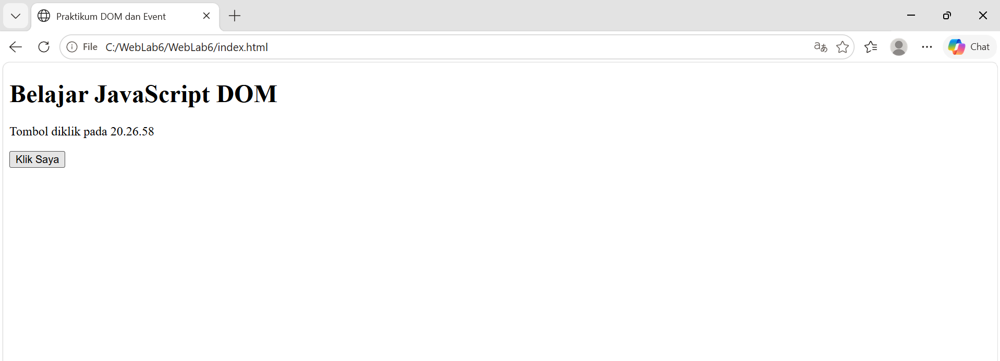
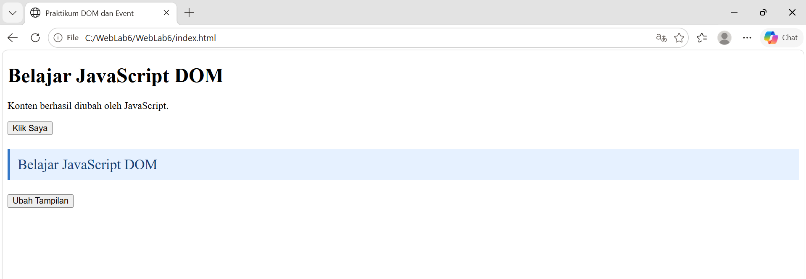
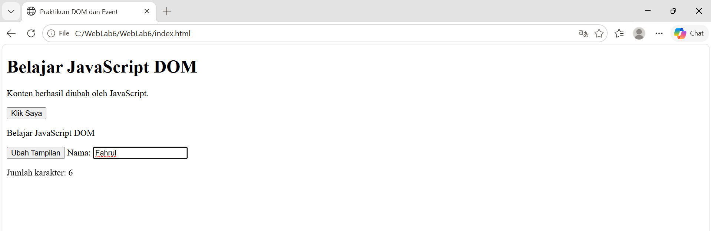
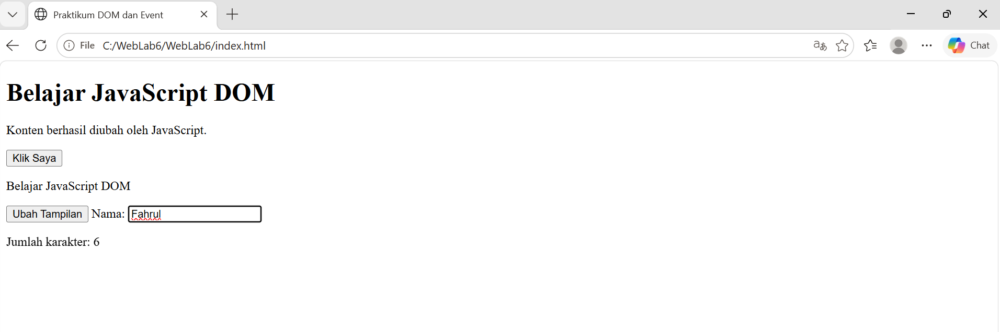
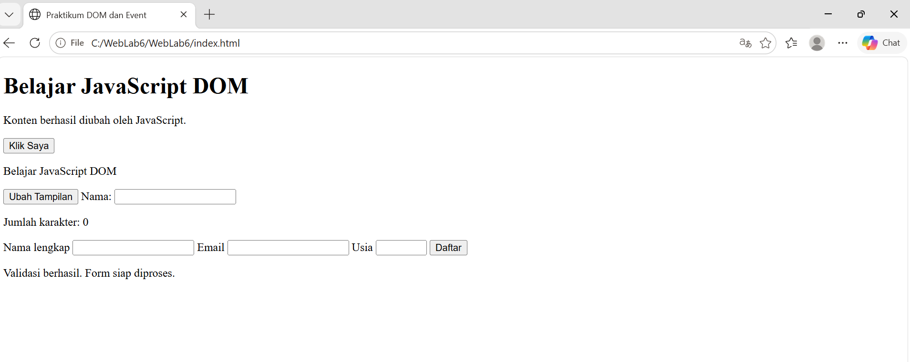
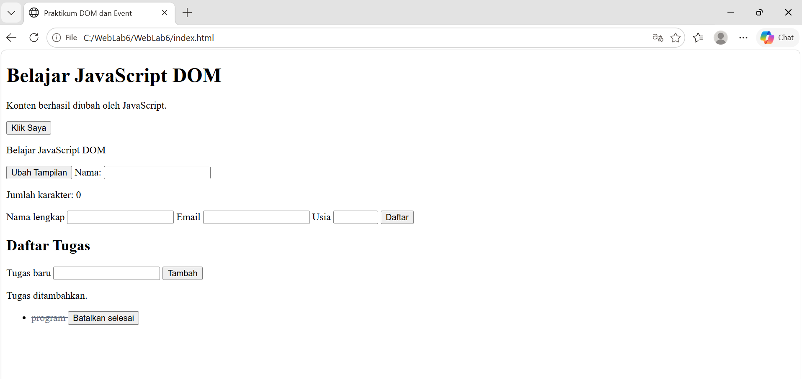
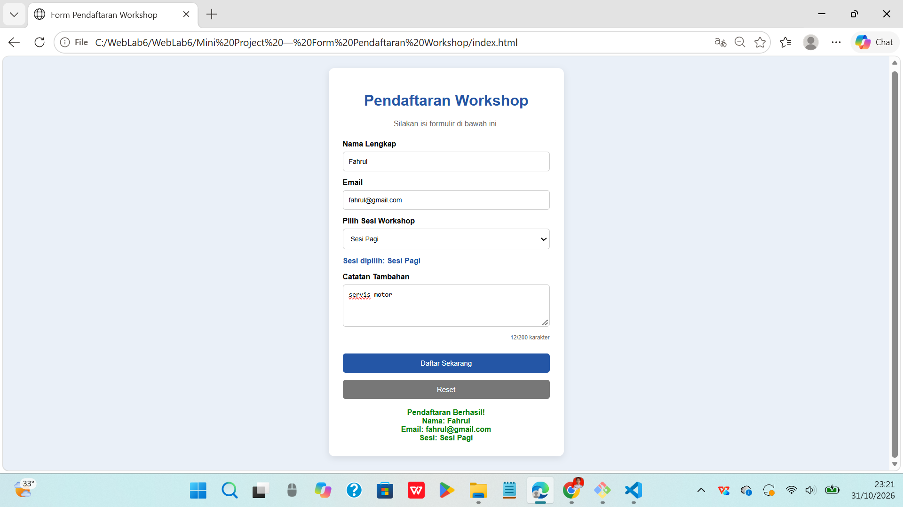

# WebLab6

## Nama: Fahrul Rahman

## Nim: 312510088

## Teknik Informatika

### Tujuan Praktikum

- Memahami konsep DOM (Document Object Model) sebagai representasi dokumen HTML yang dapat diakses melalui JavaScript.
- Menggunakan id, class, dan selector CSS untuk memilih elemen HTML.
- Mengubah teks, atribut, kelas CSS, dan gaya elemen melalui JavaScript.
- Memahami dan menggunakan event listener dengan addEventListener().
- Membuat validasi form dan menampilkan pesan sesuai kondisi input.
- Mengembangkan halaman web interaktif dengan minimal tiga fungsi yang berjalan dengan benar.

#### Cara Menjalankan Program

- siapkan aplikasi Visual Studio Code dan browser Google Chrome.
- Buat folder dengan nama Lab6Web.
- Siapkan tiga file di dalam folder tersebut, yaitu:

1. index.html
2. style.css
3. script.js

- Masukkan kode HTML ke dalam file index.html.
- Masukkan kode CSS ke dalam file style.css.
- Masukkan kode JavaScript ke dalam file script.js.
- Pastikan file CSS dan JavaScript sudah terhubung dengan file HTML.
- Buka file index.html menggunakan browser Google Chrome atau melalui Live Server di Visual Studio Code.
- Setelah halaman terbuka, lakukan pengujian pada setiap tombol, input, form, dan fitur yang tersedia.
- Periksa hasil program untuk memastikan semua fungsi berjalan dengan baik.

##### Langkah Kerja

- Latihan 1 — Mengubah Teks dengan DOM

1. Membuat elemen HTML berupa judul dan paragraf.
2. Memilih elemen menggunakan document.getElementById().
3. Mengubah teks judul menggunakan textContent.
4. Mengubah isi paragraf menggunakan JavaScript.
5. Menjalankan program dan memastikan teks berhasil berubah.

- Latihan 2 — Event Click

1. Membuat tombol dengan id tombolAksi.
2. Memilih tombol menggunakan getElementById().
3. Menggunakan addEventListener() dengan event click.
4. Menampilkan pesan dan waktu ketika tombol ditekan.
5. Menguji tombol beberapa kali.

- Latihan 3 — Mengubah Kelas dan Gaya CSS

1. Membuat paragraf dan tombol pada HTML.
2. Membuat class CSS bernama highlight dan teks-besar.
3. Menghubungkan tombol dengan event click.
4. Menggunakan classList.toggle() untuk mengubah tampilan paragraf.
5. Mengamati perubahan warna, latar belakang, dan ukuran teks.

- Latihan 4 — Penghitung Karakter

1. Membuat input teks untuk memasukkan nama.
2. Membuat elemen untuk menampilkan jumlah karakter.
3. Menggunakan event input.
4. Menghitung karakter menggunakan properti value.length.
5. Menguji dengan mengetik dan menghapus teks.

- Latihan 5 — Validasi Form Pendaftaran

1. Membuat form pendaftaran yang berisi nama lengkap, email, dan usia.
2. Mengambil nilai input menggunakan JavaScript.
3. Menggunakan event submit untuk memproses form.
4. Menggunakan event.preventDefault() agar halaman tidak dimuat ulang.
5. Memeriksa apakah nama sudah diisi.
6. Memeriksa format email.
7. Memeriksa usia antara 17 sampai 100 tahun.
8. Menampilkan pesan kesalahan apabila data tidak sesuai.
9. Menampilkan pesan berhasil apabila semua data valid.

- Latihan 6 — Daftar Tugas (To-do List)

1. Membuat kolom input untuk menuliskan tugas.
2. Membuat tombol tambah untuk memasukkan tugas.
3. Menggunakan JavaScript untuk membuat elemen daftar tugas.
4. Menampilkan tugas yang sudah ditambahkan.
5. Membuat tombol untuk menandai tugas selesai.
6. Membuat tombol hapus untuk menghapus tugas.
7. Menguji fungsi tambah, selesai, dan hapus.

- Mini Project — Form Pendaftaran Workshop

1. Membuat halaman form pendaftaran workshop.
2. Membuat input nama lengkap dan email.
3. Membuat pilihan sesi workshop menggunakan dropdown.
4. Membuat penghitung karakter nama secara otomatis.
5. Menggunakan event change untuk menampilkan sesi yang dipilih.
6. Membuat validasi nama minimal tiga karakter.
7. Memeriksa format email dan pilihan sesi.
8. Menampilkan pesan kesalahan atau keberhasilan.
9. Menampilkan ringkasan data pendaftaran.
10. Membuat tombol reset untuk menghapus input.

- Eksperimen Mandiri

1. Menambahkan tombol hapus pada setiap item To-do List.
2. Mengubah validasi nama agar minimal terdiri dari tiga karakter.
3. Menambahkan event change pada dropdown sesi workshop.
4. Membuat tombol untuk menyembunyikan dan menampilkan paragraf menggunakan class CSS.
5. Mencoba memindahkan JavaScript ke bagian head tanpa atribut defer dan mengamati kemungkinan elemen belum tersedia ketika script dijalankan.

###### Hasil Dari Latihan 1 sampai 6

###### Hasil Mini Project

